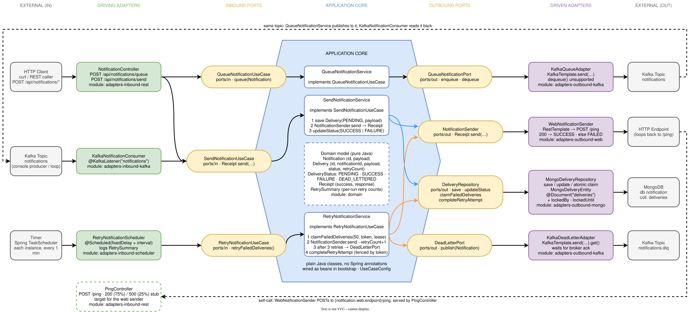
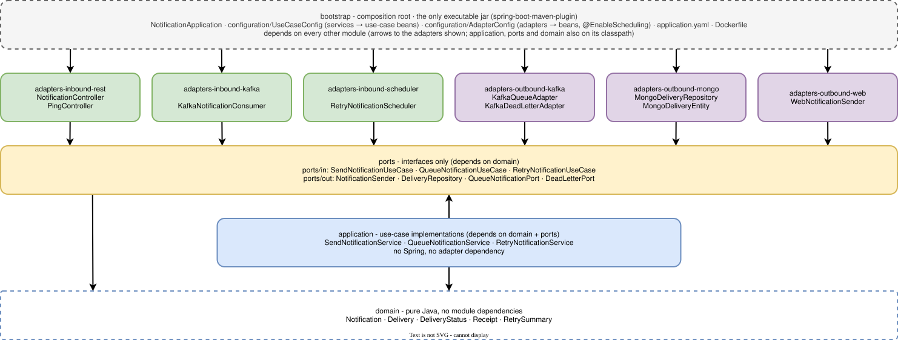

# hexagonal-architecture
This project demonstrates the core principles of Hexagonal Architecture (Ports and Adapters). The architecture ensures that business logic remains decoupled from frameworks, databases, and external APIs. By decoupling the business logic from external infrastructure, the system remains maintainable, testable, and adaptable to changing technologies.



Solid arrows show runtime call direction (orange: RetryNotificationService); compile-time (Maven) dependencies point inward to the ports. Dashed arrows are loops or stubs.

Dependency rule: adapters depend on ports; application depends only on ports and domain; domain depends on nothing.

## Structure

The notification logic (record a delivery, send it, update its status, retry it) lives in the core and only talks to ports - Java interfaces in ports/in and ports/out. REST, Kafka, the scheduler, MongoDB and the outbound HTTP call are replaceable adapters. Tests swap MongoDB for an in-memory repository and a mocked sender without touching the core.

KafkaNotificationConsumer and NotificationController are two driving adapters on the same inbound port, SendNotificationUseCase, so the Kafka path reuses exactly the same use case as REST.

RetryNotificationService deliberately does not go through SendNotificationUseCase: that use case always creates a new Delivery, which would leave the failed record untouched and reset its retryCount. Instead it uses the same outbound port (NotificationSender) and updates the existing delivery in place.

## Module dependencies: the hexagon enforced by Maven



Arrow A → B: module A depends on module B. No adapter depends on another adapter, and nothing depends on bootstrap

> [!NOTE]
> Unlike a single Maven module where the hexagon is enforced by package conventions, this app uses separate Maven modules: application physically cannot import an adapter class, and no adapter can import another adapter.

## Building and Running

### Prerequisites
- Java 21
- Maven
- Docker and Docker Compose

### Building the Application
To build the application:
```bash
mvn clean package
```

This will create a Spring Boot executable JAR in the `bootstrap/target` directory.

### Running with Docker Compose
To run the application using Docker Compose:
```bash
docker-compose up
```

This will:
1. Build the notification-service container from the bootstrap module
2. Start the Kafka broker on port 9092
3. Start the notification-service on port 8080

### Running Locally (without containers)
To run the application locally:
```bash
cd bootstrap
mvn spring-boot:run
```

The application will be available at http://localhost:8080

## Table of Contents
* [Components](docs/COMPONENTS.md)
* [Testing Methods](docs/TESTING.md)
